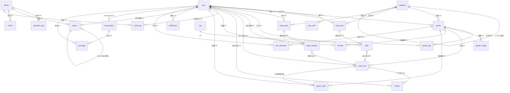

# 校园二手交易系统 · 数据库设计文档

- **版本**：v1.1（用户修订版）
- **日期**：2026-10-01
- **依据**：`需求规格说明书.md` v1.0（需求基线）；v1.1 依据用户对设计推断 T1/T3/T4/T5/T7/T8/T9/T11/T12 的修订意见定稿
- **配套脚本**：`sql/schema.sql`（可直接执行建库建表）
- **变更摘要**：表数量 23 → **27**（新增 `tag`、`goods_tag`、`goods_want`、`order_no_seq`）；核心关系改用 **41 条 InnoDB 物理外键**；软删除补齐审计字段；交换订单改双方独立确认；待处理应约/浏览去重改数据库级唯一约束；订单号改每日序列表事务生成

---

## 1. 设计约定

| 约定 | 内容 |
|------|------|
| 数据库 | MySQL 8.x，库名 `campus_secondhand`，字符集 `utf8mb4`，排序规则 `utf8mb4_0900_ai_ci`，引擎 InnoDB |
| 主键 | 所有表 `id BIGINT UNSIGNED AUTO_INCREMENT PRIMARY KEY` |
| 通用字段 | 所有业务表含 `created_at` / `updated_at`（DEFAULT CURRENT_TIMESTAMP / ON UPDATE），下文各表不再重复列出 |
| 外键（T3 修订） | **核心实体关系一律建 InnoDB 物理外键**（全库共 41 条，`fk_<表>_<字段>` 命名，RESTRICT/RESTRICT——含 STORED 生成列的表不允许 CASCADE 类动作）；**多态关联、审计对象、通知跳转**保持逻辑外键，由应用层校验 + 定期孤儿扫描兜底（模块⑦实现）。物理外键清单见 §4.2 |
| 枚举 | 状态机字段用 `VARCHAR` 大写常量（对应 Java 枚举）；简单二值用 `TINYINT` |
| 金额 | `DECIMAL(10,2)`，单位元 |
| 软删除（T4 修订） | 商品/求购帖/交换帖状态值 `DELETED` 软删，且**必须**记录 `deleted_at`、`deleted_by_type`+`deleted_by`、`delete_reason`，规则见 §3.6 删除规则表 |
| 派生字段（T5 修订） | 所有计数/会话摘要为派生字段：必须有事实表、唯一约束、事务内原子更新、定时重建机制，对照表见 §3.0 |
| 命名 | 全小写下划线；`order`/`change` 为 MySQL 保留字，分别取名 `order_info`、`score_change`（T2，维持） |
| 时间 | DATETIME，业务口径东八区；日期类字段用 `DATE` |

## 3.0 派生字段与事实来源对照表（T5 修订）

| 派生字段 | 事实来源（事实表 + 唯一约束） | 事务内原子更新时机 | 定时重建 |
|----------|------------------------------|--------------------|----------|
| `goods.view_count` | `user_behavior` 中 behavior=VIEW 的唯一行（T9 唯一键保证同人同商品同日一条） | 浏览埋点写入时 +1 | 每日全量重算 |
| `goods.favorite_count` | `favorite`（`uk_user_goods`） | 收藏/取消同事务 ±1 | 每日全量重算 |
| `goods.want_count` | `goods_want`（`uk_user_goods`） | 首次想要同事务 +1 | 每日全量重算 |
| `goods.heat_score` | 由上述三者加权（浏览1/收藏3/想要5） | 推荐任务重算 | 每小时 |
| `conversation.last_msg` / `unread1` / `unread2` | `message.read_at`（发送落库、已读打点） | 发消息/标记已读同事务 | 每日全量重算 |
| `operation_log.admin_username` | 审计快照，**非派生字段** | 写入时固化 | 不重建 |

---

## 2. ER 图

> 实线关系 = InnoDB 物理外键（T3 修订，41 条）；多态关联（report / credit_log / notification / operation_log 的 target/ref 字段）不画外键、图中以虚线语义标注。



> `order_no_seq` 为独立序列表，不与其他实体关联。

---

## 3. 表结构明细（27 张，按业务域分组编号；`sql/schema.sql` 中按依赖顺序建表）

### 3.1 user（用户表）

前台用户主表，含信用分与账号状态。

| 字段 | 类型 | 空 | 默认 | 说明 |
|------|------|:---:|------|------|
| username | VARCHAR(50) | 否 | — | 登录用户名，唯一 |
| password | VARCHAR(100) | 否 | — | BCrypt 密文（60 位） |
| nickname | VARCHAR(50) | 否 | — | 展示昵称 |
| avatar | VARCHAR(255) | 是 | NULL | 头像 URL，空=默认头像 |
| college | VARCHAR(100) | 是 | NULL | 学院 |
| bio | VARCHAR(200) | 是 | NULL | 个人简介（存库前 XSS 转义） |
| credit_score | INT | 否 | 100 | 信用分，范围 0~150 |
| auth_status | TINYINT | 否 | 0 | 0=未认证 1=已认证 |
| status | TINYINT | 否 | 0 | 0=正常 1=封禁 |
| ban_reason | VARCHAR(200) | 是 | NULL | 封禁理由 |
| banned_until | DATETIME | 是 | NULL | 封禁截止；NULL 且 status=1 表示永久封禁 |
| last_login_at | DATETIME | 是 | NULL | 最近登录时间 |

索引：`uk_username(username)`；`idx_status(status)`；`idx_created_at(created_at)`

### 3.2 user_auth（校园认证表）

物理外键：`user_id → user.id`。邮箱验证码存 Redis，不落库（T6 维持）。

| 字段 | 类型 | 空 | 默认 | 说明 |
|------|------|:---:|------|------|
| user_id | BIGINT UNSIGNED | 否 | — | 用户 ID，1:1 |
| student_no | VARCHAR(30) | 否 | — | 学号，全局唯一（一学号一账号） |
| campus_email | VARCHAR(100) | 否 | — | 校园邮箱，全局唯一 |
| status | TINYINT | 否 | 0 | 0=待验证 1=已验证 |
| verified_at | DATETIME | 是 | NULL | 验证通过时间 |

索引：`uk_user_id`；`uk_student_no`；`uk_campus_email`；FK：`fk_user_auth_user`

### 3.3 admin（管理员表）

三级 RBAC 用 `role` 字段承载；权限矩阵在代码层注解实现。

| 字段 | 类型 | 空 | 默认 | 说明 |
|------|------|:---:|------|------|
| username | VARCHAR(50) | 否 | — | 登录名，唯一 |
| password | VARCHAR(100) | 否 | — | BCrypt 密文 |
| real_name | VARCHAR(50) | 是 | NULL | 姓名 |
| role | VARCHAR(20) | 否 | — | SUPER / AUDITOR / OPERATOR（DB 大写，代码与 token 小写） |
| status | TINYINT | 否 | 0 | 0=启用 1=禁用 |
| **must_change_password** | TINYINT | 否 | 0 | **首次登录强制改密标记（T12 修订）**：初始化创建的账号置 1，改密成功后清零 |
| last_login_at | DATETIME | 是 | NULL | 最近登录时间 |

索引：`uk_username(username)`；`idx_role(role)`
初始化约定（T12 修订）：初始凭据通过**环境变量或一次性命令**注入，仓库中不保存默认明文密码；初始化**幂等**（账号已存在则跳过），首次登录强制改密。

### 3.4 category（分类表，二级树形）

**分类用于导航与筛选**（T1 修订）。

| 字段 | 类型 | 空 | 默认 | 说明 |
|------|------|:---:|------|------|
| parent_id | BIGINT UNSIGNED | 否 | 0 | 父分类 ID，0=一级分类 |
| name | VARCHAR(50) | 否 | — | 分类名（同一父级下不重名，应用层保证） |
| icon | VARCHAR(255) | 是 | NULL | 图标（URL 或前端图标名） |
| sort | INT | 否 | 0 | 排序，小者在前 |
| status | TINYINT | 否 | 0 | 0=启用 1=停用 |

索引：`idx_parent_id(parent_id)`

### 3.5 tag（标签表）【v1.1 新增，T1 修订】

**标签用于推荐的多维匹配**，与分类（导航/筛选）职责分离。

| 字段 | 类型 | 空 | 默认 | 说明 |
|------|------|:---:|------|------|
| name | VARCHAR(30) | 否 | — | 标签名，全局唯一 |
| sort | INT | 否 | 0 | 排序 |
| status | TINYINT | 否 | 0 | 0=启用 1=停用 |

索引：`uk_name(name)`
管理：后台"分类与标签管理"（PRD ADM-06）维护；不预置种子，由运营按需创建。

### 3.6 goods（商品表）

物理外键：`user_id → user.id`、`category_id → category.id`。

| 字段 | 类型 | 空 | 默认 | 说明 |
|------|------|:---:|------|------|
| user_id | BIGINT UNSIGNED | 否 | — | 卖家 ID |
| category_id | BIGINT UNSIGNED | 否 | — | 二级分类 ID（一级用于导航聚合） |
| title | VARCHAR(50) | 否 | — | 标题 |
| description | VARCHAR(500) | 否 | — | 描述 |
| price | DECIMAL(10,2) | 否 | 0.00 | 面交价，0=免费赠送 |
| condition_level | TINYINT | 否 | 1 | 成色：1全新 / 2几乎全新 / 3轻微使用痕迹 / 4明显使用痕迹 |
| course_name | VARCHAR(100) | 是 | NULL | 教材课程名（分类=教材书籍时选填） |
| isbn | VARCHAR(20) | 是 | NULL | ISBN（同上） |
| trade_location | VARCHAR(100) | 是 | NULL | 常约交易地点 |
| status | VARCHAR(20) | 否 | ON_SALE | ON_SALE在售 / IN_TRANSACTION交易中 / SOLD已售出 / OFF_SALE已下架 / DELETED已删除 |
| off_sale_reason | VARCHAR(200) | 是 | NULL | 下架理由（管理员下架必填，通知卖家） |
| **deleted_at** | DATETIME | 是 | NULL | **软删时间（T4 修订）** |
| **deleted_by_type** | VARCHAR(10) | 是 | NULL | **删除操作者类型：USER / ADMIN**（逻辑外键） |
| **deleted_by** | BIGINT UNSIGNED | 是 | NULL | **删除操作者 ID（对应 user.id 或 admin.id）** |
| **delete_reason** | VARCHAR(200) | 是 | NULL | **删除原因：管理员删除必填并通知；卖家删除默认"卖家自行删除"** |
| view_count | INT UNSIGNED | 否 | 0 | 浏览量（派生，事实=user_behavior，见 §3.0） |
| want_count | INT UNSIGNED | 否 | 0 | 想要数（派生，事实=goods_want） |
| favorite_count | INT UNSIGNED | 否 | 0 | 收藏数（派生，事实=favorite） |
| heat_score | INT | 否 | 0 | 热度分 = 浏览×1 + 收藏×3 + 想要×5，定时任务重算 |

索引：`idx_user_id`；`idx_category_status`；`idx_status_created`；`FULLTEXT ft_title_desc WITH PARSER ngram`

**删除规则表（T4 修订）**：

| 规则 | 内容 |
|------|------|
| 谁能删 | 卖家本人（自己的 ON_SALE/OFF_SALE 商品）；管理员（任意非交易中内容） |
| 禁止删除 | `status=IN_TRANSACTION`（进行中订单占用）一律拒绝删除；`SOLD` 允许删除 |
| 恢复 | 卖家删除的：30 天内可自行恢复（恢复为 OFF_SALE，再手动上架）；管理员删除的：仅管理员可恢复 |
| 历史查询 | DELETED 不进任何公开列表；卖家"我的"可见（灰态标记）；关联订单详情正常展示商品快照信息 |
| 留痕 | deleted_at / deleted_by_type + deleted_by / delete_reason 三元组必填（系统自动补默认值） |

求购帖、交换帖的软删除沿用同一套字段与规则（见 §3.10、§3.13）。

### 3.7 goods_image（商品图片表）

物理外键：`goods_id → goods.id`。每商品 1~9 张，应用层校验。

| 字段 | 类型 | 空 | 默认 | 说明 |
|------|------|:---:|------|------|
| goods_id | BIGINT UNSIGNED | 否 | — | 商品 ID |
| url | VARCHAR(255) | 否 | — | 原图 URL |
| thumb_url | VARCHAR(255) | 否 | — | 缩略图 URL |
| sort | TINYINT | 否 | 0 | 顺序 0~8 |

索引：`idx_goods_id`；FK：`fk_goods_image_goods`

### 3.8 goods_tag（商品-标签关联表）【v1.1 新增，T1 修订】

物理外键：`goods_id → goods.id`、`tag_id → tag.id`。

| 字段 | 类型 | 空 | 默认 | 说明 |
|------|------|:---:|------|------|
| goods_id | BIGINT UNSIGNED | 否 | — | 商品 ID |
| tag_id | BIGINT UNSIGNED | 否 | — | 标签 ID |

索引：`uk_goods_tag(goods_id,tag_id)`；`idx_tag_id(tag_id)`（推荐反查：按标签找商品）
约束：每个商品打 0~5 个标签，应用层校验；发布/编辑商品时全量重建关联（事务内先删后插）。

### 3.9 goods_want（"想要"事实表）【v1.1 新增，T5 修订】

`goods.want_count` 的**唯一事实来源**。买家点"想要"下单时写入。

物理外键：`user_id → user.id`、`goods_id → goods.id`、`order_id → order_info.id`。

| 字段 | 类型 | 空 | 默认 | 说明 |
|------|------|:---:|------|------|
| user_id | BIGINT UNSIGNED | 否 | — | 想要的用户 |
| goods_id | BIGINT UNSIGNED | 否 | — | 商品 |
| order_id | BIGINT UNSIGNED | 是 | NULL | 首次产生的订单 ID |

索引：`uk_user_goods(user_id,goods_id)`（一人一商品一条，重复想要不重复计）；`idx_goods_id(goods_id)`
规则：写入与 `goods.want_count+1` 同事务；订单取消**不**回退 want_count（"想要过"是事实，语义为兴趣记录）。

### 3.10 want_post（求购帖表）

物理外键：`user_id → user.id`、`category_id → category.id`。软删字段与规则同 §3.6（T4 修订）。

| 字段 | 类型 | 空 | 默认 | 说明 |
|------|------|:---:|------|------|
| user_id | BIGINT UNSIGNED | 否 | — | 求购者 ID |
| category_id | BIGINT UNSIGNED | 否 | — | 期望分类 ID |
| title | VARCHAR(50) | 否 | — | 标题 |
| description | VARCHAR(500) | 否 | — | 求购描述 |
| budget | DECIMAL(10,2) | 是 | NULL | 心理价；NULL=价格面议 |
| status | VARCHAR(20) | 否 | OPEN | OPEN求购中 / DEALT已成交 / CLOSED已关闭 / DELETED已删除 |
| deleted_at / deleted_by_type / deleted_by / delete_reason | 同 §3.6 | 是 | NULL | 软删审计三元组 |

索引：`idx_user_id`；`idx_category_id`；`idx_status_created`

### 3.11 order_info（订单表）

三种业务（出售/求购/交换）共用；状态机见需求文档 §5.3。
物理外键：`goods_id → goods.id`（可空）、`buyer_id → user.id`、`seller_id → user.id`。

| 字段 | 类型 | 空 | 默认 | 说明 |
|------|------|:---:|------|------|
| order_no | VARCHAR(32) | 否 | — | 业务单号，唯一；**由 `order_no_seq` 每日序列表事务生成（T11 修订）**，规则 `SH+yyyyMMdd+6位`，超 999999 自动扩为 7 位 |
| type | VARCHAR(10) | 否 | — | SALE=出售 / PURCHASE=求购 / SWAP=交换 |
| status | VARCHAR(20) | 否 | WAIT_CONFIRM | WAIT_CONFIRM待确认 / SCHEDULED待面交 / COMPLETED已完成 / CANCELLED已取消 |
| goods_id | BIGINT UNSIGNED | 是 | NULL | 关联商品：SALE 必填；PURCHASE/SWAP 可空 |
| buyer_id | BIGINT UNSIGNED | 否 | — | **展示角色**：SALE=下单者；PURCHASE=求购者；SWAP=发起交换方（T7 修订） |
| seller_id | BIGINT UNSIGNED | 否 | — | **展示角色**：SALE=商品发布者；PURCHASE=应约者；SWAP=帖主 |
| amount | DECIMAL(10,2) | 否 | 0.00 | 金额：SALE=商品价；PURCHASE=应约报价；SWAP=0 或差价（线下支付，平台不经手） |
| confirmed_at | DATETIME | 是 | NULL | 卖家确认时间（进入待面交；SWAP 创建即 SCHEDULED，此字段=创建时间） |
| **buyer_confirmed_at** | DATETIME | 是 | NULL | **买方完成确认时间（T7 修订）** |
| **seller_confirmed_at** | DATETIME | 是 | NULL | **卖方完成确认时间（T7 修订）** |
| completed_at | DATETIME | 是 | NULL | 完成时间 |
| cancelled_at | DATETIME | 是 | NULL | 取消时间 |
| cancelled_by | VARCHAR(10) | 是 | NULL | BUYER / SELLER / TIMEOUT |
| cancel_reason | VARCHAR(200) | 是 | NULL | 取消理由 |

索引：`uk_order_no`；`idx_goods_id`；`idx_buyer_status`；`idx_seller_status`；`idx_status_created`；`idx_confirmed_at`

**完成确认规则（T7 修订）**：

| 订单类型 | 完成条件 | 参与者模型 |
|----------|----------|------------|
| SALE / PURCHASE | `seller_confirmed_at` 写入（卖家确认收款）即完成 | buyer/seller 即实际双方 |
| SWAP | `buyer_confirmed_at` **与** `seller_confirmed_at` **都写入**才完成；双方各自独立点击"确认收到物品" | buyer/seller 仅作兼容展示角色，双发为对等参与者 |

超时扫描（`@Scheduled` 每分钟）：WAIT_CONFIRM 按 `created_at+48h`；SCHEDULED 按 `confirmed_at+15d`；取消后商品解锁回 ON_SALE。

### 3.12 offer（求购应约表）

物理外键：`want_post_id → want_post.id`、`user_id → user.id`、`order_id → order_info.id`（可空）。

| 字段 | 类型 | 空 | 默认 | 说明 |
|------|------|:---:|------|------|
| want_post_id | BIGINT UNSIGNED | 否 | — | 求购帖 ID |
| user_id | BIGINT UNSIGNED | 否 | — | 应约卖家 ID |
| price | DECIMAL(10,2) | 否 | — | 报价 |
| message | VARCHAR(200) | 是 | NULL | 留言 |
| status | TINYINT | 否 | 0 | 0待处理 / 1已接受 / 2已拒绝 / 3已撤回 |
| order_id | BIGINT UNSIGNED | 是 | NULL | 被接受后生成的订单 ID |
| **pending_key** | BIGINT UNSIGNED 生成列 | 是 | NULL | **`CASE WHEN status=0 THEN want_post_id END`（STORED，T8 修订）** |

索引：`idx_want_post`；`idx_user_id`；**`uk_offer_pending(want_post_id,user_id,pending_key)`** —— 同一用户对同一求购帖最多一条待处理应约，由数据库唯一约束保证（pending_key 为 NULL 的历史行不受限）

**接受应约的原子性（T8 修订）**：接受操作在同一事务内完成——① `SELECT ... FOR UPDATE` 锁定求购帖行；② 帖子状态置 DEALT；③ 本应约置已接受并回填 order_id；④ **该帖其余待处理应约全部置已拒绝**；⑤ 创建订单。任一步失败整体回滚。

### 3.13 swap_post（交换帖表）

物理外键：`user_id → user.id`、`category_id → category.id`。软删字段与规则同 §3.6（T4 修订）。

| 字段 | 类型 | 空 | 默认 | 说明 |
|------|------|:---:|------|------|
| user_id | BIGINT UNSIGNED | 否 | — | 帖主 ID |
| category_id | BIGINT UNSIGNED | 否 | — | 物品分类 ID |
| title | VARCHAR(50) | 否 | — | 标题 |
| my_item_desc | VARCHAR(500) | 否 | — | 我的物品描述 |
| want_item_desc | VARCHAR(500) | 否 | — | 想要的物品描述 |
| allow_diff | TINYINT | 否 | 0 | 是否接受补差价：0否 1是 |
| diff_amount | DECIMAL(10,2) | 是 | NULL | 期望差价金额 |
| status | VARCHAR(20) | 否 | OPEN | OPEN交换中 / DEALT已成交 / CLOSED已关闭 / DELETED已删除 |
| deleted_at / deleted_by_type / deleted_by / delete_reason | 同 §3.6 | 是 | NULL | 软删审计三元组 |

索引：`idx_user_id`；`idx_category_id`；`idx_status_created`

### 3.14 swap_request（交换请求表）

物理外键：`swap_post_id → swap_post.id`、`user_id → user.id`、`goods_id → goods.id`（可空）、`order_id → order_info.id`（可空）。

| 字段 | 类型 | 空 | 默认 | 说明 |
|------|------|:---:|------|------|
| swap_post_id | BIGINT UNSIGNED | 否 | — | 交换帖 ID |
| user_id | BIGINT UNSIGNED | 否 | — | 发起方 ID |
| item_desc | VARCHAR(500) | 否 | — | 发起方物品说明 |
| goods_id | BIGINT UNSIGNED | 是 | NULL | 关联发起方在售商品 |
| status | TINYINT | 否 | 0 | 0待处理 / 1已同意 / 2已拒绝 |
| order_id | BIGINT UNSIGNED | 是 | NULL | 被同意后生成的订单 ID |
| **pending_key** | 生成列 | 是 | NULL | **同 §3.12（T8 修订）** |

索引：`idx_swap_post`；`idx_user_id`；**`uk_swap_req_pending(swap_post_id,user_id,pending_key)`**

**同意交换的原子性（T8 修订）**：同一事务内——锁帖 → 帖置 DEALT → 本请求置已同意并回填 order_id → 其余待处理请求全部置已拒绝 → 创建 SWAP 订单（创建即 SCHEDULED）。

### 3.15 review（交易评价表）

物理外键：`order_id → order_info.id`、`reviewer_id → user.id`、`reviewee_id → user.id`。

| 字段 | 类型 | 空 | 默认 | 说明 |
|------|------|:---:|------|------|
| order_id | BIGINT UNSIGNED | 否 | — | 订单 ID |
| reviewer_id | BIGINT UNSIGNED | 否 | — | 评价人 ID |
| reviewee_id | BIGINT UNSIGNED | 否 | — | 被评价人 ID |
| score | TINYINT | 否 | — | 1~5 星 |
| content | VARCHAR(200) | 是 | NULL | 评价内容（敏感词校验） |

索引：`uk_order_reviewer(order_id,reviewer_id)`；`idx_reviewee(reviewee_id)`
约束：仅 COMPLETED 后 7 天内可评，双方可弃评。

### 3.16 credit_log（信用分流水表）

物理外键：`user_id → user.id`、`operator_id → admin.id`（可空）。`ref_type/ref_id` 为多态逻辑外键。

| 字段 | 类型 | 空 | 默认 | 说明 |
|------|------|:---:|------|------|
| user_id | BIGINT UNSIGNED | 否 | — | 被变动用户 |
| score_change | INT | 否 | — | 变动值，正加负减（T2：避开保留字 `change`） |
| before_score | INT | 否 | — | 变动前分值 |
| after_score | INT | 否 | — | 变动后分值 |
| reason | VARCHAR(30) | 否 | — | ORDER_COMPLETE+2 / REPORT_VALID-10 / CANCEL_TIMEOUT-2 / MALICIOUS_REPORT-5 / ADMIN_ADJUST |
| ref_type | VARCHAR(20) | 是 | NULL | 多态关联类型：ORDER / REPORT（逻辑外键 + 孤儿扫描） |
| ref_id | BIGINT UNSIGNED | 是 | NULL | 关联单据 ID |
| remark | VARCHAR(200) | 是 | NULL | 备注（ADMIN_ADJUST 必填） |
| operator_id | BIGINT UNSIGNED | 是 | NULL | 操作管理员（仅 ADMIN_ADJUST，超管专属） |

索引：`idx_user_created(user_id,created_at)`
要点：`user.credit_score` 为当前值冗余，`credit_log` 为唯一事实来源，同一事务更新。

### 3.17 favorite（收藏表）

物理外键：`user_id → user.id`、`goods_id → goods.id`。

| 字段 | 类型 | 空 | 默认 | 说明 |
|------|------|:---:|------|------|
| user_id | BIGINT UNSIGNED | 否 | — | 用户 ID |
| goods_id | BIGINT UNSIGNED | 否 | — | 商品 ID |

索引：`uk_user_goods`；`idx_goods_id`；FK：`fk_favorite_user`、`fk_favorite_goods`
要点：收藏/取消与 `goods.favorite_count±1` 同事务。

### 3.18 conversation（会话表）

物理外键：`user1_id → user.id`、`user2_id → user.id`。
`last_msg`、`unread1`、`unread2` 为**派生字段**（事实=`message.read_at`，见 §3.0），定时重建兜底。

| 字段 | 类型 | 空 | 默认 | 说明 |
|------|------|:---:|------|------|
| user1_id | BIGINT UNSIGNED | 否 | — | 会话一方，约定 user1_id < user2_id |
| user2_id | BIGINT UNSIGNED | 否 | — | 会话另一方 |
| last_msg | VARCHAR(500) | 是 | NULL | 最近消息摘要（派生） |
| last_msg_at | DATETIME | 是 | NULL | 最近消息时间（派生） |
| unread1 | INT UNSIGNED | 否 | 0 | user1 未读数（派生） |
| unread2 | INT UNSIGNED | 否 | 0 | user2 未读数（派生） |

索引：`uk_pair(user1_id,user2_id)`；`idx_user1_last`；`idx_user2_last`

### 3.19 message（消息表）

物理外键：`conversation_id → conversation.id`、`sender_id → user.id`。

| 字段 | 类型 | 空 | 默认 | 说明 |
|------|------|:---:|------|------|
| conversation_id | BIGINT UNSIGNED | 否 | — | 会话 ID |
| sender_id | BIGINT UNSIGNED | 否 | — | 发送者 ID |
| msg_type | VARCHAR(10) | 否 | TEXT | TEXT / GOODS_CARD / IMAGE |
| content | VARCHAR(500) | 否 | — | TEXT=文本（敏感词拦截）/ GOODS_CARD=商品ID / IMAGE=图片URL |
| **read_at** | DATETIME | 是 | NULL | **接收方阅读时间（T5 修订）——未读数的唯一事实依据** |

索引：`idx_conv_created(conversation_id,created_at)`；`idx_conv_read(conversation_id,read_at)`（重建未读数用）
要点：消息先落库再 WebSocket 推送；对端阅读时写入 read_at，与未读数-1 同事务。

### 3.20 notification（站内通知表）

物理外键：`user_id → user.id`。`ref_type/ref_id` 为跳转多态逻辑外键。

| 字段 | 类型 | 空 | 默认 | 说明 |
|------|------|:---:|------|------|
| user_id | BIGINT UNSIGNED | 否 | — | 接收人 |
| type | VARCHAR(20) | 否 | — | ORDER / AUDIT / REPORT / CREDIT / SYSTEM |
| title | VARCHAR(100) | 否 | — | 标题 |
| content | VARCHAR(500) | 否 | — | 内容 |
| ref_type | VARCHAR(20) | 是 | NULL | 跳转类型（逻辑外键 + 孤儿扫描） |
| ref_id | BIGINT UNSIGNED | 是 | NULL | 跳转对象 ID |
| is_read | TINYINT | 否 | 0 | 0未读 1已读 |

索引：`idx_user_read`；`idx_user_created`

### 3.21 report（举报表）

物理外键：`reporter_id → user.id`、`handler_id → admin.id`（可空）。`target_type/target_id` 为多态逻辑外键。

| 字段 | 类型 | 空 | 默认 | 说明 |
|------|------|:---:|------|------|
| reporter_id | BIGINT UNSIGNED | 否 | — | 举报人 |
| target_type | VARCHAR(10) | 否 | — | GOODS / WANT / SWAP / USER |
| target_id | BIGINT UNSIGNED | 否 | — | 被举报对象 ID |
| report_type | VARCHAR(20) | 否 | — | VIOLATION / FRAUD / COUNTERFEIT / OTHER |
| description | VARCHAR(500) | 是 | NULL | 补充描述 |
| images | JSON | 是 | NULL | 截图 URL 数组 ≤3（T10 维持） |
| status | TINYINT | 否 | 0 | 0待处理 / 1已处置 / 2已驳回 |
| result | VARCHAR(200) | 是 | NULL | 处置说明 |
| handler_id | BIGINT UNSIGNED | 是 | NULL | 处置管理员 |
| handled_at | DATETIME | 是 | NULL | 处置时间 |

索引：`idx_status_created`；`idx_target(target_type,target_id)`

### 3.22 sensitive_word（敏感词表）

| 字段 | 类型 | 空 | 默认 | 说明 |
|------|------|:---:|------|------|
| word | VARCHAR(50) | 否 | — | 敏感词，唯一 |

索引：`uk_word(word)`；DFA 全量内存加载，后台增删后刷新缓存。

### 3.23 banner（轮播图表）

| 字段 | 类型 | 空 | 默认 | 说明 |
|------|------|:---:|------|------|
| title | VARCHAR(50) | 是 | NULL | 标题（管理端备注） |
| image_url | VARCHAR(255) | 否 | — | 图片 URL |
| link_url | VARCHAR(255) | 是 | NULL | 跳转链接 |
| sort | INT | 否 | 0 | 排序 |
| status | TINYINT | 否 | 0 | 0下线 1上线 |

索引：`idx_status_sort(status,sort)`

### 3.24 notice（公告表）

物理外键：`publisher_id → admin.id`。

| 字段 | 类型 | 空 | 默认 | 说明 |
|------|------|:---:|------|------|
| title | VARCHAR(100) | 否 | — | 公告标题 |
| content | VARCHAR(2000) | 否 | — | 公告内容 |
| status | TINYINT | 否 | 0 | 0草稿 / 1发布 / 2下线 |
| publisher_id | BIGINT UNSIGNED | 否 | — | 发布管理员 |
| published_at | DATETIME | 是 | NULL | 发布时间 |

索引：`idx_status_published(status,published_at)`

### 3.25 operation_log（后台操作日志表）

物理外键：`admin_id → admin.id`（操作者）；`target_type/target_id` 为审计对象多态逻辑外键（T3 修订）。

| 字段 | 类型 | 空 | 默认 | 说明 |
|------|------|:---:|------|------|
| admin_id | BIGINT UNSIGNED | 否 | — | 操作管理员 |
| admin_username | VARCHAR(50) | 否 | — | 审计快照（非派生，写入固化） |
| action | VARCHAR(50) | 否 | — | 动作枚举（见 v1.0 §3.22 清单，新增 ADMIN_RESET_PASSWORD 等） |
| target_type | VARCHAR(20) | 是 | NULL | 操作对象类型（逻辑外键 + 孤儿扫描） |
| target_id | BIGINT UNSIGNED | 是 | NULL | 操作对象 ID |
| detail | VARCHAR(500) | 是 | NULL | 参数与理由 |
| ip | VARCHAR(45) | 否 | — | 来源 IP |

索引：`idx_admin_created`；`idx_created`；只写不改不删。

### 3.26 user_behavior（用户行为表）

物理外键：`user_id → user.id`、`goods_id → goods.id`。推荐模块（REC-01~03）原始输入。

| 字段 | 类型 | 空 | 默认 | 说明 |
|------|------|:---:|------|------|
| user_id | BIGINT UNSIGNED | 否 | — | 用户 ID |
| goods_id | BIGINT UNSIGNED | 否 | — | 商品 ID |
| behavior | VARCHAR(10) | 否 | — | VIEW / FAVORITE / ORDER_DONE |
| **behavior_date** | DATE | 否 | — | **业务日期（写入时取当天，T9 修订）** |
| **view_day_key** | DATE 生成列 | 是 | NULL | **`CASE WHEN behavior='VIEW' THEN behavior_date END`（STORED，T9 修订）** |

索引：**`uk_behavior_view_day(user_id,goods_id,behavior,view_day_key)`** —— VIEW 同人同商品同日仅一条，**由数据库唯一索引保证并发安全**（非 VIEW 行 view_day_key 为 NULL，不受限，ORDER_DONE 可同日多次）；`idx_user_behavior`；`idx_behavior_goods`
要点：行为权重（5/3/1）在推荐计算时映射，不落库；VIEW 写入冲突时静默忽略（不重复计浏览）。

### 3.27 order_no_seq（订单号每日序列表）【v1.1 新增，T11 修订】

| 字段 | 类型 | 空 | 默认 | 说明 |
|------|------|:---:|------|------|
| seq_date | DATE | 否 | — | 业务日期，主键 |
| seq_val | BIGINT UNSIGNED | 否 | 0 | 当日已用序号 |

**取号模式（两步式，事务内；实测修正）**：

```sql
INSERT IGNORE INTO order_no_seq (seq_date, seq_val) VALUES (?, 0);
UPDATE order_no_seq SET seq_val = LAST_INSERT_ID(seq_val + 1) WHERE seq_date = ?;
SELECT LAST_INSERT_ID();  -- 当日序号，从 1 开始
```

要点：与订单插入同事务（行锁串行化当日取号）；**不能用单语句 upsert**——本表无自增列，当天首次取号走 insert 路径时 `LAST_INSERT_ID()` 返回 0（实测发现），两步式保证首次即为 1；`order_no` 唯一索引保留为最终防线；**序列溢出处理**——序号 >999999 后位数自动扩展为 7 位（`order_no` VARCHAR(32) 容量充足，唯一性不受影响）。

---

## 4. 设计推断变更记录（v1.0 → v1.1）

### 4.1 修订对照表（用户 2026-10-01 审阅意见，全部采纳）

| # | v1.0 原方案 | **v1.1 用户修订（定稿）** | 落点 |
|---|-------------|---------------------------|------|
| T1 | 二级分类承担标签职能 | **分类管导航/筛选，标签管推荐匹配**；新增 `tag` + `goods_tag` 表 | §3.5、§3.8；发布表单选 0~5 个标签；REC-01 按标签+分类双维匹配 |
| T3 | 全库逻辑外键 | **核心实体关系用 InnoDB 物理外键**；多态关联/审计对象/通知跳转保持逻辑外键 + 应用校验 + **定期孤儿扫描** | DDL 41 条 FK；孤儿扫描定时任务（模块⑦） |
| T4 | 软删仅状态值 | **软删必须记录删除时间/操作者/原因**；定义删除、恢复、订单期间禁删、历史查询规则 | §3.6 删除规则表；goods/want_post/swap_post 各加 4 列 |
| T5 | 冗余计数约定 | **派生字段必须有事实表+唯一约束+事务内原子更新+定时重建**；**"想要"必须独立事实表** | §3.0 对照表；新增 goods_want；message 加 read_at |
| T7 | buyer/seller 语义约定 | **交换订单双方参与者模型，buyer/seller 仅兼容展示角色；双方独立确认后才完成** | order_info 加 buyer/seller_confirmed_at；完成规则表 |
| T8 | 应用层保证唯一 | **数据库唯一约束 + 事务锁共同保证**；接受时**原子关帖并拒绝其他待处理请求** | offer/swap_request 生成列 pending_key + uk；原子接受流程 |
| T9 | 应用层同日去重 | **按用户/商品/行为/业务日期去重，由数据库唯一索引保证并发安全** | user_behavior 加 behavior_date + view_day_key 生成列唯一键 |
| T11 | 订单号序列来自自增/Redis | **独立每日序列表事务生成**；唯一索引保留；**处理序列溢出** | 新增 order_no_seq；取号 SQL 模式 |
| T12 | 工程初始化类创建超管 | **凭据经环境变量/一次性命令注入，仓库无默认明文；首次登录强制改密；初始化幂等** | admin 加 must_change_password；初始化约定 |

**维持原案（未修订）**：T2（`order`→`order_info`、`change`→`score_change` 避保留字）、T6（验证码只存 Redis）、T10（report.images 用 JSON）。

### 4.2 物理外键清单（T3 修订，共 41 条）

| 表 | 外键 → 引用 |
|----|-------------|
| user_auth | user_id → user |
| goods | user_id → user；category_id → category |
| goods_image | goods_id → goods |
| goods_tag | goods_id → goods；tag_id → tag |
| goods_want | user_id → user；goods_id → goods；order_id → order_info |
| want_post | user_id → user；category_id → category |
| order_info | goods_id → goods；buyer_id → user；seller_id → user |
| offer | want_post_id → want_post；user_id → user；order_id → order_info |
| swap_post | user_id → user；category_id → category |
| swap_request | swap_post_id → swap_post；user_id → user；goods_id → goods；order_id → order_info |
| review | order_id → order_info；reviewer_id → user；reviewee_id → user |
| credit_log | user_id → user；operator_id → admin |
| favorite | user_id → user；goods_id → goods |
| conversation | user1_id → user；user2_id → user |
| message | conversation_id → conversation；sender_id → user |
| notification | user_id → user |
| report | reporter_id → user；handler_id → admin |
| notice | publisher_id → admin |
| operation_log | admin_id → admin |
| user_behavior | user_id → user；goods_id → goods |

**逻辑外键（多态/审计/跳转，应用校验 + 孤儿扫描）**：`report.target_*`、`credit_log.ref_*`、`notification.ref_*`、`operation_log.target_*`、`goods/want_post/swap_post.deleted_by`（配合 deleted_by_type）。

### 4.3 对其他文档的影响

| 文档 | 影响 |
|------|------|
| 需求规格说明书 | 不改版。ADM-06"分类与标签管理"由此有了实体落点；GDS-01 发布表单增加"标签多选（0~5）"，属设计细化，不新增需求编号 |
| 前端设计文档 | 发布商品表单加标签多选；GoodsCard/商品详情展示标签；订单详情时间线按订单类型区分单/双确认（已同步修改） |
| 交接文档 | 下一阶段实体层验收标准由 23 个实体类更新为 **27 个** |

---

## 5. 需求覆盖核对

与 v1.0 一致，新增两处落点：REC-01 推荐匹配维度由"分类"升级为"标签+分类"（goods_tag）；ADM-06 标签管理实体化（tag）。其余映射关系见 v1.0 §5，全部维持有效。

---

## 6. 配套 SQL

- 文件：`sql/schema.sql`（v1.1）
- 内容：建库、**27 张建表语句**（含 41 条物理外键、生成列唯一约束、表/字段 COMMENT）、10 个一级分类种子
- 执行（重置式验证）：`DROP DATABASE IF EXISTS campus_secondhand;` 后 `mysql -u root -p < sql/schema.sql`
- 默认超管凭据：环境变量注入 + 幂等初始化 + 首次登录强制改密（T12），不在 SQL 中
